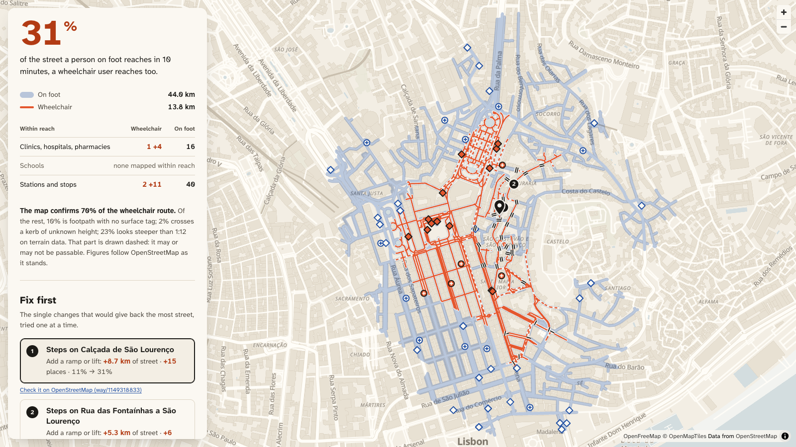
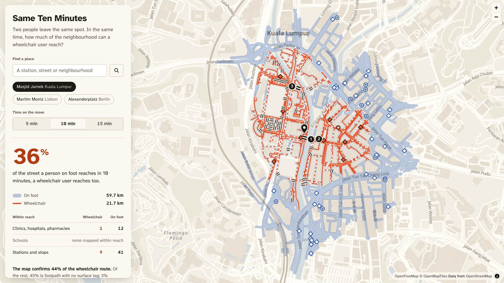
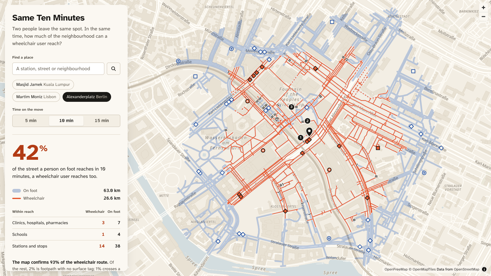
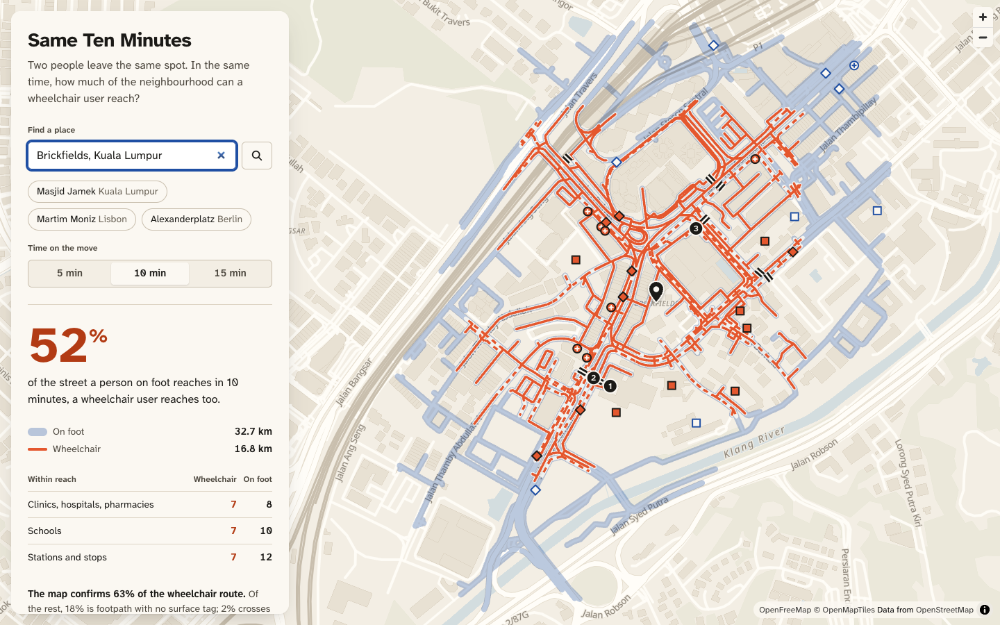
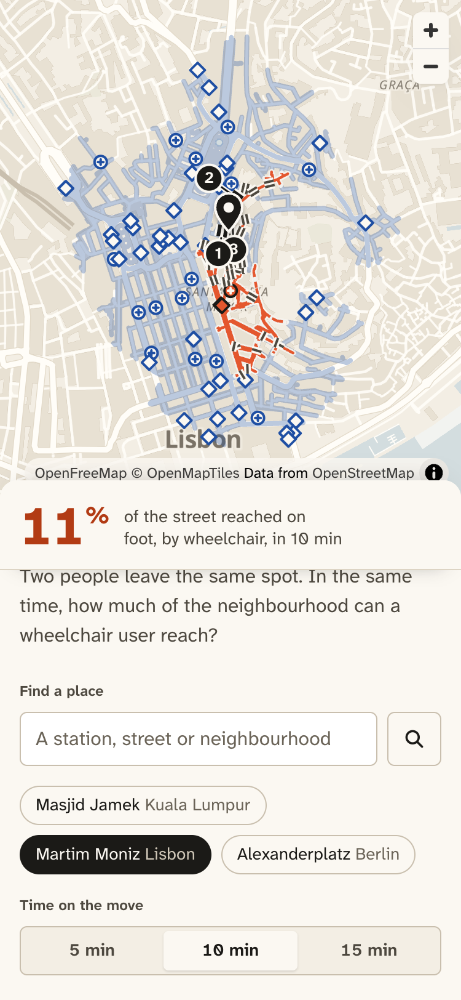

# Same Ten Minutes

**Drop a pin. Two inks spread along the real streets for the same ten minutes: one for a person on foot, one for a person in a manual wheelchair. The wheelchair ink stops at every staircase, raised kerb and rough path. Then the app names the single fix that gives back the most of the neighbourhood, and shows the ink flooding through when it is made.**



Step-free routers answer "how do I get from A to B". Same Ten Minutes answers two different questions, the ones a resident, an advocate or a council needs before spending money:

1. **How big is the gap?** From this spot, what share of the streets, clinics, schools and stations that a walker reaches can a wheelchair user reach in the same time?
2. **Which one fix closes it most?** Every barrier on the edge of the wheelchair reach is removed in turn, the reach is recomputed, and the barriers are ranked by the street length and places they give back.

It is also a measuring tool a community can run on its own streets, for free, instead of a clipboard survey: it shows exactly where the map is silent, links every barrier to OpenStreetMap so it can be checked and corrected, and prints a one-page audit sheet.

## What you see

- **The gap figure**: wheelchair reach as a share of walking reach, by street length.
- **Places within reach**: clinics, hospitals and pharmacies; schools; stations and stops. Wheelchair *n* of walking *m*.
- **Data confidence**: how much of the wheelchair route the map actually confirms. Footpaths with no surface tag, kerbs of unknown height and slopes that look too steep on terrain data are drawn dashed and counted separately. The result is always "according to the map as it stands".
- **Fix first**: the top three barriers, each with its gain and a link to the OpenStreetMap object.
- **5, 10 or 15 minutes**, a shareable link that restores the pin and time, and a printable audit sheet.

Everything is computed in the browser from open data. Nothing on screen is typed in by hand.

## Sample places (bundled)

Figures for 10 minutes, as the app computes them from the bundled extracts:

| Place | Wheelchair reach vs on foot | Map confirms | Top fix |
|---|---|---|---|
| Martim Moniz, Lisbon | 11% (5.1 of 44.0 km) | 70% | Steps on Calçada de São Lourenço: 31%, +15 places |
| Masjid Jamek, Kuala Lumpur | 36% (21.7 of 59.7 km) | 44% | Steps near Muzium Tekstil Negara: 50% |
| Alexanderplatz, Berlin | 42% (26.6 of 63.0 km) | 93% | Rough surface off Dircksenstraße: 46% |

Open one directly with `#place=lisbon-martim-moniz`, `#place=kl-masjid-jamek` or `#place=berlin-alexanderplatz`.

| | |
|---|---|
|  |  |
|  |  |

The printed audit sheet: [`assets/audit-sheet-berlin.pdf`](assets/audit-sheet-berlin.pdf).

## Run it

Requires Node 22 or newer (`npm run fetch-areas` runs TypeScript directly and needs Node 23.6 or newer).

```bash
npm install
npm run dev        # http://localhost:5173
npm test           # unit tests for the routing engine and the fix ranking
npm run build      # static site in dist/, deployable to GitHub Pages as is
npm run preview    # serve dist/ on http://localhost:4173
```

End-to-end check (keyboard only, against the built site; needs a local Chrome or Chromium):

```bash
npm run build && npm run preview -- --port 4173 &
CHROME_PATH="/path/to/chrome" npm run e2e
```

No API keys, accounts or environment variables. The sample places are bundled in `public/areas/`, so they work without any public API. Any other place is fetched live when you search for it or drop a pin outside the bundled areas.

To refresh the bundled areas (one request per area, cached in `data-cache/`):

```bash
npm run fetch-areas
```

## How it works

- **Street graph.** OpenStreetMap ways a person can walk on (footways, paths, steps, pedestrian streets and ordinary streets; never motorways), one edge per pair of consecutive nodes so the ink follows every bend. Kerbs, crossings, gates and tagged widths, surfaces and inclines are kept.
- **Slope.** Elevation is sampled from Terrain Tiles (terrarium encoding) at every node and the gradient of each edge is measured over an 80 m baseline along its street.
- **Two profiles.** Directed travel times for walking and for a manual wheelchair on every edge (uphill and downhill differ).
- **Reach.** Time-budgeted Dijkstra from the pin, per profile, in a Web Worker. Partly reached edges are drawn and counted up to the exact point reached.
- **Fix first.** Only a barrier touching the current wheelchair reach can change it, so only those are tried; each is opened alone and the reach recomputed. A unit test checks this ranking against brute force over every barrier.
- **The ink.** A canvas over the map fills each segment at its computed arrival time, so the animation is the routing result played back, and the gap figure counts on the same clock.

## Method

All thresholds live in [`src/engine/profiles.ts`](src/engine/profiles.ts). They are a model of a typical manual wheelchair user; real limits vary from person to person.

| Rule | Value | Basis |
|---|---|---|
| Walking speed, flat | 1.33 m/s (4.8 km/h) | typical pedestrian speed |
| Walking speed on slopes | Tobler's hiking function, capped at the flat speed | Tobler (1993) |
| Walking speed on stairs | 0.6 m/s horizontal | assumption |
| Wheelchair speed, flat | 1.0 m/s (3.6 km/h) | assumption, typical self-propelled pace on pavement |
| Wheelchair slows from | 3% gradient, to 55% of flat speed at the limit | assumption |
| Wheelchair gradient limit | 1:12 (8.33%) | maximum ramp slope in ADA 2010 Standards §405.2; the same limit appears in many national codes |
| Minimum clear width | 0.9 m (only where `width` is tagged) | ADA 2010 §403.5.1 (36 in) |
| Blocks a wheelchair | `highway=steps` without a ramp, `kerb=raised`, turnstiles, stiles and kissing gates, `wheelchair=no`, loose or rough `surface` / bad `smoothness`, tagged `incline` beyond 1:12 | OpenStreetMap tags |
| Never faster than walking | wheelchair time ≥ walking time on every edge | so walking reach always contains wheelchair reach (tested) |
| A fixed staircase | modelled as a 1:12 ramp | assumption |

**Unconfirmed, not hidden.** Where the map does not say, the street is treated as passable but drawn dashed and left out of the confirmed share:

- footpaths with no `surface`, `smoothness` or `wheelchair` tag (ordinary streets are assumed paved);
- crossings and `barrier=kerb` nodes without a kerb height;
- slopes beyond 1:12 that come only from terrain data. Terrain Tiles are built from ~30 m elevation data, which cannot judge a single street and is noisy under tall buildings. In central Kuala Lumpur the terrain model gives a median street gradient of about 6%, which is not plausible street by street; in Hong Kong Central it is about 14%, so that area was not bundled. So by default a terrain-only slope is flagged and slowed, not blocked. The "Count steep terrain as impassable" switch blocks it instead, and a tagged `incline` always counts.

**Places** are amenities tagged clinic, hospital, pharmacy, doctors, school or kindergarten, railway stations and bus stops, each joined to the nearest street node within 100 m.

## Data, licences and politeness

- Street data © [OpenStreetMap contributors](https://www.openstreetmap.org/copyright), available under the Open Database Licence (ODbL). The bundled extracts in `public/areas/` are derived from OpenStreetMap and carry the same licence; each file records the date of the data it was built from.
- Elevation: [Terrain Tiles on AWS](https://registry.opendata.aws/terrain-tiles/) (Mapzen terrarium format). See that dataset's attribution notes for its sources.
- Basemap: [OpenFreeMap](https://openfreemap.org) vector tiles, © OpenMapTiles, data from OpenStreetMap.
- Live data comes from the public [Overpass API](https://wiki.openstreetmap.org/wiki/Overpass_API) and place search from [Nominatim](https://nominatim.org). The app sends one search request per submitted query (no search-as-you-type), one Overpass request per new area, and caches every area in the browser so it is never fetched twice. The bundled sample places need neither service.

## Accessibility of the app itself

- Everything works by keyboard: place search, sample places, time, the fixes, and the map itself (focus it, pan with the arrow keys, press Enter to drop the pin at the centre).
- The result is also a plain-language sentence in a live region for screen readers.
- The two inks differ by width and the unconfirmed one by dash pattern, not by colour alone; blue and vermilion stay distinct with the common colour-vision deficiencies. Text meets WCAG AA contrast.
- `prefers-reduced-motion` shows final states with a short cross-fade instead of the spread.
- Typeface: Atkinson Hyperlegible Next, designed for low-vision readers.

## Known limits

- The result is only as good as the map. Kerbs and surfaces are thinly tagged in many cities; the confidence figure says how thin.
- Terrain slopes are a coarse estimate (see Method).
- Indoor routes, lifts and opening hours are not modelled; a mapped lift is not yet used as a way around steps.
- One manual-wheelchair profile; other mobility profiles are not built yet.
- Live areas depend on the public Overpass and Nominatim services being available.

## Licence

Code: MIT, see [LICENSE](LICENSE). Bundled map data: ODbL, see above.
